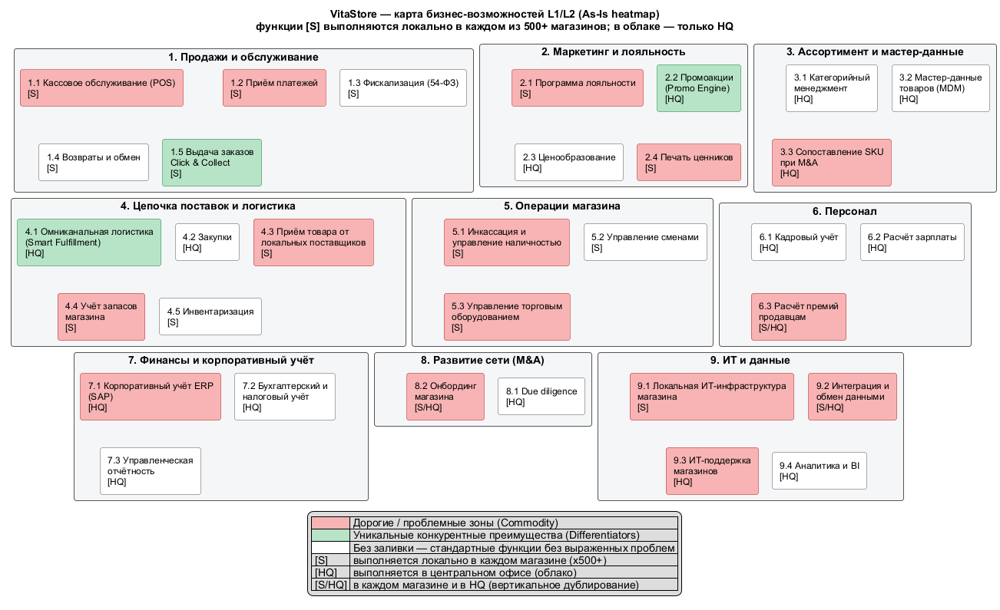

# 2. Карта бизнес-возможностей L1/L2 (Heatmap)

Карта описывает **что** делает бизнес VitaStore, а не **чем** это делается. В неё вошли функции магазина и HQ из постановки и базовые логические блоки ритейла, без которых карта неполна.

Периметр As-Is: функции магазина выполняются **локально в каждом из 500+ магазинов** — и в собственных, и в купленных ([ADR-002](adr/ADR-002-scope-all-stores.md)). В облаке работает только HQ ([ADR-001](adr/ADR-001-hq-in-cloud.md)).

Принцип To-Be: у каждой функции магазина логическая часть (правила, расчёты, данные) уходит в облако, физическая — остаётся в магазине. Это показывает поле **To-Be** в расшифровке ниже.

## Диаграмма

Исходник: [capability-map.puml](capability-map.puml).

### Легенда

| Цвет | Значение |
| ---- | -------- |
| 🔴 Красный | Дорогие или проблемные зоны (Commodity): стандартная функция с высокой стоимостью владения, дублированием или подтверждёнными инцидентами |
| 🟢 Зелёный | Уникальные конкурентные преимущества (Differentiators) |
| Без заливки | Стандартные функции без выраженных проблем в артефактах |

Метки контура: **[S]** — локально в каждом магазине (×500+), **[HQ]** — центральный офис (облако), **[S/HQ]** — и в каждом магазине, и в HQ (вертикальное дублирование).

## Расшифровка карты

### 1. Продажи и обслуживание

- **1.1 Кассовое обслуживание (POS)** — контур **S**, 🔴
  - **As-Is:** В каждом магазине — своя касса: у собственных толстый клиент C# + Local DB, у купленных — их системы; 500+ серверов и лицензий Windows Server / SQL.
  - **To-Be:** Планшет кассира (тонкий клиент) с офлайн-буфером.
- **1.2 Приём платежей** — контур **S**, 🔴
  - **As-Is:** Драйверы терминалов зашиты в кассовое приложение; новый протокол (ARCUS-2) — 3 недели разработки и срыв открытия (INC-8415).
  - **To-Be:** Платёжный терминал (PIN-pad).
- **1.3 Фискализация (54-ФЗ)** — контур **S**, без заливки
  - **As-Is:** Регламентированная функция, проблем в артефактах нет.
  - **To-Be:** ККТ с фискальным накопителем, печать кассового чека.
- **1.4 Возвраты и обмен** — контур **S**, без заливки
  - **As-Is:** Стандартная функция.
  - **To-Be:** Приём товара от покупателя, печать чека возврата.
- **1.5 Выдача заказов Click & Collect** — контур **S**, 🟢
  - **As-Is:** Точка выдачи омниканальных заказов — часть главного конкурентного преимущества.
  - **To-Be:** Хранение и выдача заказа покупателю.

### 2. Маркетинг и лояльность

- **2.1 Программа лояльности** — контур **S**, 🔴
  - **As-Is:** Ведётся в каждом магазине «в тетрадке»: у покупателя нет единого счёта, у сети — данных; попытка онлайн-проверки карт ломается без интернета (INC-8402).
  - **To-Be:** Ничего (кроме идентификации карты на кассе).
- **2.2 Промоакции (Promo Engine)** — контур **HQ**, 🟢
  - **As-Is:** Единый собственный движок промо для всей сети, инструмент дифференциации.
  - **To-Be:** Промо-материалы в зале.
- **2.3 Ценообразование** — контур **HQ**, без заливки
  - **As-Is:** Цены задаются централизованно (проблема в доставке цен, а не в самом ценообразовании — см. 9.2).
  - **To-Be:** Ничего.
- **2.4 Печать ценников** — контур **S**, 🔴
  - **As-Is:** Каждый магазин формирует и печатает ценники сам по данным из Local DB после ночной FTP-выгрузки; при отказе сервера (INC-8433) ценники не обновляются.
  - **To-Be:** Принтер ценников / электронные ценники, наклейка на полку.

### 3. Ассортимент и мастер-данные

- **3.1 Категорийный менеджмент** — контур **HQ**, без заливки
  - **As-Is:** Стандартная функция коммерческого департамента.
  - **To-Be:** Выкладка по планограмме.
- **3.2 Мастер-данные товаров (MDM)** — контур **HQ**, без заливки
  - **As-Is:** Справочник ведётся в ERP; отдельного MDM нет, но в артефактах это не названо проблемой.
  - **To-Be:** Ничего.
- **3.3 Сопоставление SKU при M&A** — контур **HQ**, 🔴
  - **As-Is:** VLOOKUP и ручной разбор ~80% ассортимента, 500 позиций/час на сотрудника, до 2 недель на магазин (Артефакты 2, 4).
  - **To-Be:** Ничего (выгрузка данных старой кассы — удалённо).

### 4. Цепочка поставок и логистика

- **4.1 Омниканальная логистика (Smart Fulfillment)** — контур **HQ**, 🟢
  - **As-Is:** Главное конкурентное преимущество: любой товар со склада в магазин у дома.
  - **To-Be:** Приём и хранение поставок со склада.
- **4.2 Закупки** — контур **HQ**, без заливки
  - **As-Is:** Централизованные закупки в ERP.
  - **To-Be:** Ничего.
- **4.3 Приём товара от локальных поставщиков** — контур **S**, 🔴
  - **As-Is:** Каждый магазин принимает и учитывает товар локальных поставщиков сам, вне ERP: нет сквозного учёта остатков и цен закупки.
  - **To-Be:** Физическая приёмка, пересчёт, хранение товара.
- **4.4 Учёт запасов магазина** — контур **S**, 🔴
  - **As-Is:** Остатки в Local DB каждого магазина, синхронизация раз в сутки — HQ и Click & Collect видят устаревшие данные; Real-time на схеме не подтверждён.
  - **To-Be:** Хранение товара.
- **4.5 Инвентаризация** — контур **S**, без заливки
  - **As-Is:** Стандартная функция.
  - **To-Be:** Физический пересчёт (ТСД / планшет).

### 5. Операции магазина

- **5.1 Инкассация и управление наличностью** — контур **S**, 🔴
  - **As-Is:** Каждый магазин ведёт учёт наличности и инкассации сам; при отказе карт (INC-8402) растёт доля наличных.
  - **To-Be:** Хранение наличных, передача инкассатору.
- **5.2 Управление сменами** — контур **S**, без заливки
  - **As-Is:** Стандартная функция.
  - **To-Be:** Открытие / закрытие смены на кассе.
- **5.3 Управление торговым оборудованием** — контур **S**, 🔴
  - **As-Is:** Разнородный парк ККТ и терминалов (COM/USB), уникальные драйверы, блокирует стандартизацию.
  - **To-Be:** Стандартный комплект устройств.

### 6. Персонал

- **6.1 Кадровый учёт** — контур **HQ**, без заливки
  - **As-Is:** Ведётся централизованно в ERP.
  - **To-Be:** Ничего.
- **6.2 Расчёт зарплаты** — контур **HQ**, без заливки
  - **As-Is:** Ведётся централизованно в ERP.
  - **To-Be:** Ничего.
- **6.3 Расчёт премий продавцам** — контур **S/HQ**, 🔴
  - **As-Is:** Каждый магазин считает премии локально в обход HR-модуля ERP — 500+ локальных расчётов и вертикальный дубль с HQ.
  - **To-Be:** Ничего.

### 7. Финансы и корпоративный учёт

- **7.1 Корпоративный учёт ERP (SAP)** — контур **HQ**, 🔴
  - **As-Is:** Вендор ушёл с российского рынка: нет обновлений и поддержки, регуляторные риски ([ADR-003](adr/ADR-003-sap-to-1c.md)).
  - **To-Be:** Ничего.
- **7.2 Бухгалтерский и налоговый учёт** — контур **HQ**, без заливки
  - **As-Is:** Стандартная функция.
  - **To-Be:** Ничего.
- **7.3 Управленческая отчётность** — контур **HQ**, без заливки
  - **As-Is:** Стандартная функция.
  - **To-Be:** Ничего.

### 8. Развитие сети (M&A)

- **8.1 Due diligence** — контур **HQ**, без заливки
  - **As-Is:** Проблем в артефактах нет.
  - **To-Be:** Ничего.
- **8.2 Онбординг магазина** — контур **S/HQ**, 🔴
  - **As-Is:** Выезд ИТ-бригады, ручной перенос данных, 2 недели при цели 5 дней; ~10 магазинов в месяц.
  - **To-Be:** Установка стандартного комплекта устройств.

### 9. ИТ и данные

- **9.1 Локальная ИТ-инфраструктура магазина** — контур **S**, 🔴
  - **As-Is:** Сервер в подсобке в каждом магазине; отказ диска останавливает магазин на 4–6 часов (INC-8433).
  - **To-Be:** Роутер с резервным LTE-каналом; сервера нет.
- **9.2 Интеграция и обмен данными** — контур **S/HQ**, 🔴
  - **As-Is:** Ночной XML по FTP, email с CSV; Real-time REST на схеме не существует.
  - **To-Be:** Ничего.
- **9.3 ИТ-поддержка магазинов** — контур **HQ**, 🔴
  - **As-Is:** 40% ИТ-бюджета уходит на поддержку серверов; Team Store Ops перегружена легаси.
  - **To-Be:** Замена устройства из подменного фонда.
- **9.4 Аналитика и BI** — контур **HQ**, без заливки
  - **As-Is:** Стандартная функция; ограничена суточной задержкой данных из магазинов.
  - **To-Be:** Ничего.
