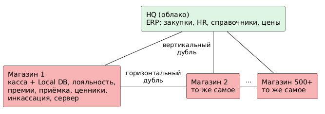

# 3. Дублирующиеся и дорогие в поддержке функции

Анализ опирается на карту возможностей ([02-capability-map.md](02-capability-map.md)), артефакты Discovery и [ADR-002](adr/ADR-002-scope-all-stores.md). Каждый из 500+ магазинов локально решает одни и те же задачи, в облаке работает только HQ.

## 3.1 Дублирующиеся функции

Дублирование бывает двух видов:

* **горизонтальное** — одна и та же функция реализована отдельно в каждом магазине (N копий, N = 500+ и растёт на ~10 в месяц);
* **вертикальное** — функция реализована и в магазине, и в HQ, то есть у данных два источника правды.

### Диаграмма

Исходник: [dublication.puml](./dublication.puml)

### Горизонтальное дублирование (магазин против магазина)

* **H1 — 1.1 Кассовое обслуживание**
  * **Что повторяется:** кассовое ПО + Local DB + бизнес-логика продаж (у собственных — толстый клиент C#, у купленных — свои системы).
  * **Последствия:** 500+ установок для обновления и поддержки; у купленных — ещё и разные продукты.
  * **Источник:** Артефакт 1; постановка Task1.
* **H2 — 2.1 Программа лояльности**
  * **Что повторяется:** ведение лояльности «в тетрадке».
  * **Последствия:** покупатель не может копить и тратить баллы в другом магазине; у сети нет единой базы клиентов и данных для Promo Engine.
  * **Источник:** постановка Task1; INC-8402.
* **H3 — 6.3 Расчёт премий продавцам**
  * **Что повторяется:** локальные правила и расчёт премий.
  * **Последствия:** 500+ разных расчётов, нет единых правил мотивации, ручная сверка с ФОТ.
  * **Источник:** постановка Task1.
* **H4 — 4.3 Приём товара от локальных поставщиков**
  * **Что повторяется:** учёт приёмки и расчёты с поставщиком на уровне магазина.
  * **Последствия:** остатки и себестоимость не видны HQ; Click & Collect не может опираться на эти остатки.
  * **Источник:** постановка Task1.
* **H5 — 4.4 Учёт запасов / справочники**
  * **Что повторяется:** копия справочников, цен и остатков в Local DB.
  * **Последствия:** 500+ копий данных, расхождения до суток.
  * **Источник:** Артефакт 1; Артефакт 2, п. 7.1.
* **H6 — 2.4 Печать ценников**
  * **Что повторяется:** формирование макетов и печать по локальным данным.
  * **Последствия:** ценники отстают от цен HQ; при отказе сервера не обновляются.
  * **Источник:** Артефакт 2, п. 7.1; INC-8433.
* **H7 — 5.1 Инкассация**
  * **Что повторяется:** локальный учёт наличности и инкассации.
  * **Последствия:** нет сквозной сверки «касса — инкассация — банк» на уровне сети.
  * **Источник:** постановка Task1.
* **H8 — 5.3 Управление оборудованием**
  * **Что повторяется:** свой набор драйверов ККТ и терминалов.
  * **Последствия:** каждый новый протокол — доработка и пересборка кассы (3 недели).
  * **Источник:** INC-8415.
* **H9 — 9.1 ИТ-инфраструктура**
  * **Что повторяется:** сервер в подсобке (Windows Server + СУБД).
  * **Последствия:** 500+ одинаковых мини-ЦОД без резервирования.
  * **Источник:** Артефакт 1; INC-8433.

### Вертикальное дублирование (магазин против HQ)

* **V1**
  * **В магазине:** локальный расчёт премий (H3).
  * **В HQ:** HR-модуль ERP (кадры и зарплата).
  * **Последствия:** два источника правды по ФОТ.
  * **Источник:** описание кейса; постановка Task1.
* **V2**
  * **В магазине:** приёмка от локальных поставщиков (H4).
  * **В HQ:** закупки в ERP + Smart Fulfillment.
  * **Последствия:** две независимые цепочки поставок.
  * **Источник:** постановка Task1.
* **V3**
  * **В магазине:** справочники и цены в Local DB (H5).
  * **В HQ:** справочник номенклатуры и цены в ERP.
  * **Последствия:** ночная рассылка XML по FTP, суточная задержка.
  * **Источник:** Артефакт 2, п. 7.1.
* **V4**
  * **В магазине:** лояльность «в тетрадке» (H2).
  * **В HQ:** лояльность в ERP (по Артефакту 1).
  * **Последствия:** центральные данные лояльности не совпадают с фактическими начислениями в магазинах.
  * **Источник:** Артефакт 1; постановка Task1.

## 3.2 Дорогие в поддержке функции

* **C1 — 9.1 Локальная ИТ-инфраструктура**
  * **Драйвер затрат:** железо, лицензии Windows Server / SQL, администрирование, выезды инженеров — × 500+.
  * **Количественные признаки:** 500+ серверов; простой 4–6 ч при отказе диска; 40% ИТ-бюджета уходит на поддержку серверов.
  * **Источник:** Cost Driver 2; INC-8433; постановка Task1.
* **C2 — 8.2 Онбординг магазина**
  * **Драйвер затрат:** командировки ИТ-бригады, ФОТ товароведов.
  * **Количественные признаки:** до 2 недель на магазин, ~10 магазинов в месяц.
  * **Источник:** Cost Driver 1; Артефакт 4.
* **C3 — 3.3 Сопоставление SKU при M&A**
  * **Драйвер затрат:** ручной труд категорийных менеджеров.
  * **Количественные признаки:** ~80% ассортимента разбирается вручную; 500 позиций в час; fuzzy-скрипты дают ложные срабатывания и риск продажи в минус.
  * **Источник:** Артефакты 2, 4.
* **C4 — 1.2 Приём платежей / 5.3 Оборудование**
  * **Драйвер затрат:** разработка драйверов, пересборка монолита.
  * **Количественные признаки:** 3 недели на один протокол; срыв открытия магазина №205.
  * **Источник:** Cost Driver 3; INC-8415.
* **C5 — 2.1 Лояльность**
  * **Драйвер затрат:** упущенная выручка, ручной учёт в каждом магазине.
  * **Количественные признаки:** отказы покупателей от покупок.
  * **Источник:** INC-8402.
* **C6 — 6.3 Премии, 4.3 Приёмка, 5.1 Инкассация, 2.4 Ценники**
  * **Драйвер затрат:** время персонала магазина на учётные операции × 500+.
  * **Количественные признаки:** каждая операция выполняется вручную в каждом магазине.
  * **Источник:** постановка Task1.
* **C7 — 9.2 Интеграция и обмен данными**
  * **Драйвер затрат:** поддержка FTP / email-конвейеров, ночные окна.
  * **Количественные признаки:** суточная задержка данных; Real-time REST на схеме не существует.
  * **Источник:** Артефакт 1 (комментарий); Артефакт 2.
* **C8 — 9.3 ИТ-поддержка магазинов**
  * **Драйвер затрат:** перегрузка Team Store Ops легаси-тикетами.
  * **Количественные признаки:** тикеты INC-8402, 8415, 8433 — типовые для парка.
  * **Источник:** Артефакт 3.
* **C9 — 7.1 Корпоративный учёт ERP (SAP)**
  * **Драйвер затрат:** поддержка без вендора, дорогие специалисты, регуляторный риск.
  * **Количественные признаки:** вендор ушёл из РФ.
  * **Источник:** [ADR-003](adr/ADR-003-sap-to-1c.md).

## 3.3 Выводы

1. **Главный источник затрат — горизонтальное дублирование.** Одни и те же задачи решаются 500+ раз на 500+ комплектах ПО и железа (H1–H9, C1, C6, C8). Затраты растут линейно с числом магазинов, то есть с темпом M&A.
2. **To-Be убирает N копий логики, но оставляет N точек физических операций.** Правила, расчёты, справочники, остатки, лояльность, премии, учёт приёмки и инкассации становятся едиными облачными сервисами. В магазине остаются хранение товара, физическая приёмка, печать чеков и ценников, PIN-pad, передача наличных и выдача заказов.
3. **Вертикальные дубли (V1–V4) закрываются тем же переносом:** у каждой функции остаётся один источник правды — облачный сервис или 1С ([ADR-003](adr/ADR-003-sap-to-1c.md)).
4. **Онбординг дорог (C2, C3)**, потому что каждый новый магазин приносит ещё один комплект локальных реализаций. При облачном стандарте онбординг сводится к сопоставлению SKU и установке типового комплекта устройств — это вход в Task2.
5. **Связка «драйвер внутри кассы» должна быть разорвана** через Payment Gateway и стандартный протокол работы с ККТ (H8, C4).

Целевые модели для каждой зоны — в [04-sourcing-strategy.md](04-sourcing-strategy.md).
