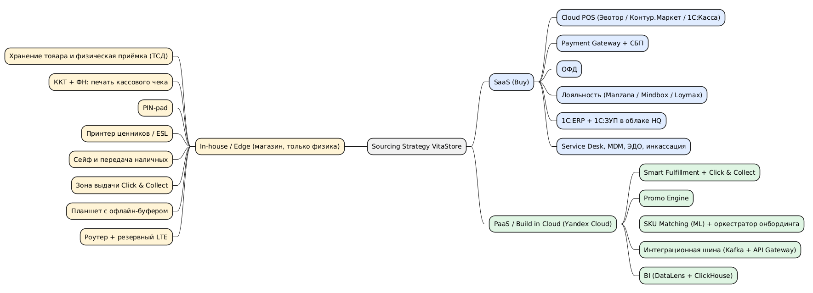

# 4. Sourcing Strategy и матрица Buy vs Build

## 4.1 Правила принятия решения

1. **Физическая и логическая часть.** As-Is: каждый из 500+ магазинов локально решает одни и те же задачи ([ADR-002](adr/ADR-002-scope-all-stores.md)). To-Be: у каждой функции логическая часть (правила, расчёты, справочники, остатки, документы) становится **одним общим облачным сервисом для всей сети**. В магазине остаётся только физическая часть — то, что требует присутствия человека, товара или устройства.
2. **Differentiator (🟢 на карте)** → собственная разработка на PaaS. Покупка коробки лишит сеть конкурентного преимущества.
3. **Commodity (🔴 или без заливки)** → SaaS, если на российском рынке есть продукт со штатной интеграцией с 1С. Иначе — PaaS с минимумом собственного кода.
4. **Физика и закон** → в магазине остаётся только то, без чего нельзя хранить и продать товар (см. §4.3).
5. **Данные** хранятся в РФ (152-ФЗ). Персональные данные участников программы лояльности хранятся только у российского SaaS-провайдера или в Yandex Cloud.
6. **Все магазины** — и собственные, и купленные — переводятся на один целевой стек. Локальные реализации выводятся из эксплуатации.

## 4.2 Матрица решений Buy vs Build

### SaaS (Buy)

- **1.1 Кассовое обслуживание (POS)** — 🔴 Commodity
  - **Пересмотрено в Task3:** Cloud POS — собственная разработка на PaaS Yandex Cloud ([ADR-006](../Task3/adr/ADR-006-own-cloud-pos.md)); решение ниже — исходное.
  - **As-Is:** своя касса в каждом магазине: толстый клиент C# + Local DB у собственных, свои системы у купленных.
  - **Решение:** Cloud POS: Эвотор / Контур.Маркет / 1С:Касса (1С:Розница в облаке).
  - **Остаётся в магазине:** планшет кассира с офлайн-буфером.
  - **Обоснование:** стандартная функция без конкурентного преимущества; одна облачная касса вместо 500+ установок; убирает Local DB и сервер; штатная интеграция с 1С и ОФД.
- **1.2 Приём платежей** — 🔴 Commodity
  - **As-Is:** драйверы терминалов внутри кассы (USB / ARCUS-2).
  - **Решение:** мультиэквайринговый Payment Gateway процессингового центра (класс решений UCS / ИНПАС / Сбер SmartPOS) + СБП по QR.
  - **Остаётся в магазине:** платёжный терминал (PIN-pad), QR-дисплей.
  - **Обоснование:** касса работает с единым API шлюза, а не с драйвером терминала; новый банк подключается настройкой, а не пересборкой (INC-8415).
- **2.1 Программа лояльности** — 🔴 Commodity
  - **As-Is:** «тетрадка» в каждом магазине.
  - **Решение:** Manzana Loyalty / Mindbox / Loymax.
  - **Остаётся в магазине:** идентификация карты / телефона на кассе.
  - **Обоснование:** одна база клиентов вместо 500+ тетрадок; офлайн-кэш на кассе (INC-8402); ПДн хранятся в РФ.
- **2.4 Печать ценников** — 🔴 Commodity
  - **As-Is:** каждый магазин формирует ценники по Local DB после ночной выгрузки.
  - **Решение:** макеты и задания на печать формирует Cloud POS по событию изменения цены в 1С; на развитие — электронные ценники (ESL).
  - **Остаётся в магазине:** принтер ценников или ESL, наклейка на полку.
  - **Обоснование:** один сервис формирования ценников; нет зависимости от сервера в подсобке и ночного окна.
- **4.3 Приём товара от локальных поставщиков** — 🔴 Commodity
  - **As-Is:** учёт приёмки в каждом магазине, вне ERP.
  - **Решение:** документы приёмки в Cloud POS / ТСД с проводкой в 1С:ERP; поставщик заводится в 1С, документы через ЭДО.
  - **Остаётся в магазине:** физическая приёмка, пересчёт, хранение.
  - **Обоснование:** функция сохраняется, но учёт становится общим; остатки видны Smart Fulfillment.
- **4.4 Учёт запасов магазина** — 🔴 Commodity
  - **As-Is:** Local DB каждого магазина, синхронизация раз в сутки.
  - **Решение:** остатки в Cloud POS + 1С:ERP, обмен событиями почти в реальном времени.
  - **Остаётся в магазине:** хранение товара.
  - **Обоснование:** 500+ Local DB ликвидируются; Click & Collect получает актуальные остатки.
- **4.5 Инвентаризация** — Commodity
  - **As-Is:** локально в каждом магазине.
  - **Решение:** модуль инвентаризации Cloud POS / ТСД с выгрузкой в 1С:ERP.
  - **Остаётся в магазине:** физический пересчёт.
  - **Обоснование:** результаты сразу попадают в общий учёт.
- **5.3 Управление торговым оборудованием** — 🔴 Commodity
  - **As-Is:** уникальные драйверы в каждом магазине.
  - **Решение:** стандартный комплект: планшет + ККТ АТОЛ / Штрих-М + PIN-pad; MDM для планшетов (Kaspersky Endpoint Security for Mobile / SafePhone).
  - **Остаётся в магазине:** типовой комплект устройств.
  - **Обоснование:** единый стандарт оборудования; драйверы платёжных терминалов уходят в Payment Gateway.
- **9.3 ИТ-поддержка магазинов** — 🔴 Commodity
  - **As-Is:** Team Store Ops, выезды.
  - **Решение:** Service Desk: Naumen Service Desk / SimpleOne / Okdesk; удалённое управление планшетами через MDM.
  - **Остаётся в магазине:** замена устройства из подменного фонда.
  - **Обоснование:** меньше выездов; поддержка стандартного стека вместо 500+ легаси-установок.

### SaaS (Buy) + In-house

- **1.3 Фискализация** — Commodity
  - **As-Is:** ККТ по COM-порту в каждом магазине.
  - **Решение:** ОФД: Платформа ОФД / Такском / Контур.ОФД; ККТ АТОЛ / Штрих-М.
  - **Остаётся в магазине:** ККТ с ФН, печать кассового чека.
  - **Обоснование:** 54-ФЗ требует ККТ в месте расчёта; передача чеков в ФНС через ОФД — стандартный сервис.

### SaaS (Buy) / аутсорсинг

- **5.1 Инкассация** — 🔴 Commodity
  - **As-Is:** учёт наличности в каждом магазине.
  - **Решение:** банковская инкассация (Сбер / Росинкас), при необходимости — умные сейфы; учёт и сверка со сменами в Cloud POS и 1С.
  - **Остаётся в магазине:** хранение наличных, передача инкассатору.
  - **Обоснование:** сквозная сверка «касса — инкассация — банк» на уровне сети.

### SaaS/PaaS (Buy)

- **2.3 Ценообразование** — Commodity
  - **As-Is:** ERP HQ (SAP).
  - **Решение:** 1С:ERP.
  - **Обоснование:** стандартная функция ERP ([ADR-003](adr/ADR-003-sap-to-1c.md)).
- **3.2 Мастер-данные товаров** — Commodity
  - **As-Is:** справочник SAP + 500+ копий в Local DB.
  - **Решение:** справочник номенклатуры 1С:ERP + данные Национального каталога (ГС1 РУС / Честный ЗНАК).
  - **Обоснование:** один эталонный справочник без локальных копий; GTIN из Нацкаталога — опорный ключ сопоставления.
- **4.2 Закупки** — Commodity
  - **As-Is:** ERP HQ (SAP).
  - **Решение:** 1С:ERP + ЭДО (Контур.Диадок / СБИС).
  - **Обоснование:** стандартный процесс.
- **6.1–6.2 Кадровый учёт и зарплата** — Commodity
  - **As-Is:** ERP HQ (SAP HR).
  - **Решение:** 1С:ЗУП.
  - **Обоснование:** [ADR-003](adr/ADR-003-sap-to-1c.md).
- **6.3 Расчёт премий продавцам** — 🔴 Commodity
  - **As-Is:** локальный расчёт в каждом магазине + HR в HQ.
  - **Решение:** 1С:ЗУП; данные о продажах продавца — из Cloud POS.
  - **Обоснование:** один расчёт по единым правилам вместо 500+ локальных; вертикальный дубль с HQ закрыт.
- **7.1 Корпоративный учёт ERP** — 🔴 Commodity (вендорский риск)
  - **As-Is:** SAP ERP в HQ.
  - **Решение:** 1С:ERP / 1С:ERP Управление холдингом на IaaS Yandex Cloud (сервер 1С + Managed PostgreSQL) либо 1С:Фреш.
  - **Обоснование:** Commodity → покупка; уход SAP из РФ ([ADR-001](adr/ADR-001-hq-in-cloud.md), [ADR-003](adr/ADR-003-sap-to-1c.md)).
- **7.2 Бухгалтерский и налоговый учёт** — Commodity
  - **As-Is:** ERP HQ (SAP).
  - **Решение:** 1С:ERP + ЭДО.
  - **Обоснование:** регламентированный учёт РФ.

### PaaS / SaaS

- **9.4 Аналитика и BI** — Commodity
  - **As-Is:** ограничена суточной задержкой.
  - **Решение:** Yandex DataLens + Managed ClickHouse.
  - **Обоснование:** стандартный стек BI в целевом облаке.

### PaaS (Build in Cloud)

- **1.5 Выдача Click & Collect** — 🟢 Differentiator
  - **As-Is:** часть Smart Fulfillment.
  - **Решение:** модуль Smart Fulfillment; на кассе — экран выдачи через API.
  - **Остаётся в магазине:** хранение и выдача заказа.
  - **Обоснование:** часть главного конкурентного преимущества.
- **2.2 Промоакции (Promo Engine)** — 🟢 Differentiator
  - **As-Is:** собственный движок HQ.
  - **Решение:** Yandex Managed Kubernetes + Managed PostgreSQL + Managed Kafka; правила промо доставляются в Cloud POS через API.
  - **Остаётся в магазине:** промо-материалы в зале.
  - **Обоснование:** уникальная логика сети; развивается собственной командой.
- **3.3 Сопоставление SKU при M&A** — 🔴 Commodity (уникальный конвейер)
  - **As-Is:** VLOOKUP + ручной разбор ~80%.
  - **Решение:** Yandex DataSphere (ML / эмбеддинги, YandexGPT) + Managed PostgreSQL (pgvector) + интерфейс подтверждения для товароведа (human-in-the-loop).
  - **Обоснование:** готового продукта под задачу на рынке нет; конвейер M&A — внутренняя компетенция, которая масштабирует рост сети. Детали — Task2.
- **8.2 Онбординг магазина** — 🔴 Commodity
  - **As-Is:** выезд бригады, ручной перенос.
  - **Решение:** оркестратор процесса онбординга на базе BPMN-движка в Managed Kubernetes + сервис сопоставления SKU (3.3) + шаблоны подключения Cloud POS.
  - **Остаётся в магазине:** установка типового комплекта устройств.
  - **Обоснование:** процесс уникален для M&A-модели VitaStore; собирается из облачных сервисов. Детали — Task2.
- **9.2 Интеграция и обмен данными** — 🔴 Commodity
  - **As-Is:** ночной XML по FTP, email с CSV.
  - **Решение:** Yandex Managed Kafka / Message Queue + API Gateway; коннекторы 1С ↔ Cloud POS ↔ Promo Engine ↔ Smart Fulfillment.
  - **Обоснование:** событийная интеграция вместо ночного окна; магазинам больше нечего синхронизировать — данные уже в облаке.

### PaaS (Migrate / Build in Cloud)

- **4.1 Омниканальная логистика (Smart Fulfillment)** — 🟢 Differentiator
  - **As-Is:** собственная система HQ.
  - **Решение:** Yandex Managed Kubernetes, Managed PostgreSQL, Managed Kafka; интеграция с 1С через событийную шину.
  - **Остаётся в магазине:** приём и хранение поставок со склада.
  - **Обоснование:** главное конкурентное преимущество — только собственное развитие.

### Ликвидация → In-house edge (минимум)

- **9.1 Локальная ИТ-инфраструктура** — 🔴 Commodity
  - **As-Is:** сервер в подсобке в каждом магазине (Windows Server + СУБД).
  - **Остаётся в магазине:** роутер с резервным LTE-каналом; сервера нет.
  - **Обоснование:** 500+ серверов и лицензий выводятся; без отказа диска нет простоя магазина (INC-8433).

## 4.3 In-house / On-Premise: что остаётся в магазине

В магазине остаётся только то, что требует физического присутствия. Вся логика и все данные этих операций — в облаке.

| Физическая операция            | Устройство / ресурс в магазине | Почему нельзя перенести                                              | Где логика и данные                |
| ------------------------------ | ------------------------------ | -------------------------------------------------------------------- | ---------------------------------- |
| Хранение товара, выкладка      | Торговый зал, склад магазина   | Товар физически находится в магазине                                 | Остатки — Cloud POS + 1С:ERP       |
| Физическая приёмка и пересчёт  | ТСД / планшет                  | Товар нужно принять и пересчитать на месте                           | Документы приёмки — 1С:ERP, ЭДО    |
| Печать кассового чека          | ККТ с фискальным накопителем   | 54-ФЗ: ККТ должна находиться в месте расчёта                         | Чеки — ОФД; продажи — Cloud POS    |
| Приём оплаты картой            | Платёжный терминал (PIN-pad)   | Физический ввод PIN, требования платёжных систем (PCI PTS)           | Платёжная логика — Payment Gateway |
| Печать и размещение ценников   | Принтер ценников или ESL       | Ценник физически находится на полке                                  | Макеты и цены — Cloud POS / 1С     |
| Хранение и передача наличных   | Сейф / умный сейф              | Наличные физически находятся в магазине                              | Учёт инкассации — Cloud POS / 1С   |
| Выдача заказов Click & Collect | Зона выдачи                    | Покупатель забирает товар в магазине                                 | Заказы — Smart Fulfillment         |
| Продажа при обрыве интернета   | Планшет с офлайн-буфером       | Кэш цен, остатков и лояльности, отложенная отправка чеков (INC-8402) | Источник данных — облачные сервисы |
| Связь с облаком                | Роутер с резервным LTE-каналом | Минимизация офлайн-режима                                            | —                                  |

## 4.4 Сводка

Исходник: [sourcing-strategy.puml](./sourcing-strategy.puml)

Итог:

- 500+ локальных реализаций **одних и тех же функций заменяются едиными** облачными сервисами.
- **Commodity**-функции **переходят на российский SaaS** с ядром учёта на 1С.
- **Differentiators** (Smart Fulfillment с Click & Collect, Promo Engine) и уникальный M&A-конвейер (SKU Matching, онбординг) **развиваются собственной командой** на управляемых сервисах Yandex Cloud.
- **В каждом магазине** остаются **только физические операции** и устройства для них.
