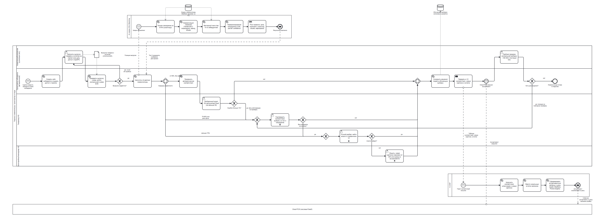

# To-Be процесс переноса номенклатуры купленного магазина

Периметр — перенос номенклатуры: от выгрузки базы товаров купленного магазина до корректного ассортимента, цен и остатков на кассе Cloud POS ([ADR-004](adr/ADR-004-onboarding-scope-and-channel.md)). Монтаж устройств и подключение кассы идут параллельно и описаны в Task3.

## 1. As-Is: где возникают ручной труд и ошибки

| Шаг регламента | Что происходит | Проблема |
| --- | --- | --- |
| 4.1-4.2 | Выездной инженер снимает дамп старой кассы и шлёт по email | Командировка ради файла; формат выгрузки произвольный |
| 5.1 | Товаровед делает VLOOKUP по штрихкодам с базой ERP | Пустые и «чужие» штрихкоды не находятся |
| 5.2 | Товаровед вручную разбирает ~80% позиций (500 позиций/ч) | ~16 чел.-часов на магазин, человеческий фактор — 15% ошибок |
| 6.1 | Итоговый файл загружается в ERP | Нет проверки цены и смысла соответствия |
| 7.1 | Ночной XML по FTP на Local DB | Ошибка видна только на кассе: не бьётся штрихкод, неверная цена |

## 2. To-Be: диаграмма



Исходник: [onboarding-sku-matching.bpmn](onboarding-sku-matching.bpmn) (BPMN 2.0 XML с диаграммой; открывается в Camunda Modeler или на [demo.bpmn.io](https://demo.bpmn.io)).

### Пулы и роли

| Пул / дорожка | Тип | Роль в процессе |
| --- | --- | --- |
| AI-сервис SKU Matching | Система | Сопоставляет позиции со справочником VitaStore: GTIN, нормализация YandexGPT, векторный поиск, rerank, риск-правила (Yandex DataSphere, Managed PostgreSQL + pgvector) |
| Перенос номенклатуры: оркестратор и люди | Процесс | Пул процесса, исполняемого BPMN-движком онбординга (Sourcing Strategy, 8.2). Дорожки: |
| — Управляющий магазином (купленная сеть) | Человек | Загружает выгрузку, проводит пробную продажу |
| — Оркестратор онбординга | Система | Валидация, вызов AI, распределение по коридорам, передача в 1С, контроль сроков |
| — Товаровед HQ | Человек | Аудит автоматического коридора, подтверждение топ-3, ручной разбор |
| — Категорийный менеджер HQ | Человек | Новая карточка или вывод позиции без аналога |
| 1С:ERP | Система | Эталонный справочник, соответствия штрихкодов, начальные остатки, ассортиментная матрица и цены ([ADR-003](../Task1/adr/ADR-003-sap-to-1c.md)) |
| Cloud POS | Система (black box) | Получает ассортимент и цены событием из шины, подтверждает загрузку |

Задачи людей помечены маркером multi-instance: в BPMN-движке они исполняются по каждой позиции очереди, а в интерфейсе товароведа выглядят как список карточек.

### Шаги процесса

1. **Старт.** Департамент M&A закрывает сделку, оркестратор создаёт кейс онбординга и выдаёт управляющему магазином доступ к порталу.
2. **Загрузка.** Управляющий загружает выгрузку товаров и остатков по шаблону (CSV/XLS) или подключает коннектор к своей кассовой БД/API. Инженер не выезжает.
3. **Валидация.** Оркестратор проверяет схему файла, обязательные поля, дубли и контрольную сумму EAN-13. При ошибках управляющий получает отчёт и загружает файл заново — за минуты, а не через новую командировку.
4. **AI-маппинг.** Оркестратор отправляет позиции в AI-сервис и получает для каждой топ-3 кандидата, confidence и риск-флаги (раздел 3).
5. **Распределение по коридорам** (inclusive gateway: одна выгрузка содержит позиции всех коридоров):
   - от 95% без флагов — автоматическое применение и выборочный аудит;
   - 70-95% или есть риск-флаг — подтверждение товароведом;
   - меньше 70% — ручной разбор.
6. **Аудит автоматического коридора.** Товаровед проверяет случайные 3% (не меньше 50 позиций). При ошибках выше 1% весь автоматический коридор магазина уходит на подтверждение.
7. **Подтверждение.** Товаровед выбирает один из топ-3 кандидатов. Если все отклонены — позиция уходит в ручной разбор.
8. **Ручной разбор.** Товаровед ищет аналог в справочнике 1С. Если аналога нет — категорийный менеджер заводит новую карточку по черновику ИИ или выводит позицию из ассортимента.
9. **Обучающая выборка.** Все решения людей сохраняются как размеченные пары и пополняют синонимы и индекс эмбеддингов.
10. **Передача в 1С.** Оркестратор отправляет таблицу соответствий, новые карточки и остатки. 1С:ERP загружает соответствия штрихкодов, вводит начальные остатки, формирует ассортиментную матрицу и цены магазина из прайса VitaStore и Promo Engine, публикует событие в шину (Managed Kafka).
11. **Загрузка в Cloud POS.** Касса забирает ассортимент и цены и подтверждает загрузку. Ночного FTP-окна нет.
12. **Пробная продажа.** Управляющий сканирует контрольную выборку ~100 SKU тестовым чеком без фискализации. Расхождения возвращают позиции на подтверждение, иначе номенклатура готова к открытию.

## 3. Поток данных автоматического маппинга

| Шаг AI-сервиса | Вход | Выход |
| --- | --- | --- |
| Точное совпадение по GTIN | Штрихкод позиции, индекс штрихкодов справочника 1С | Кандидат с confidence 100% или «нет совпадения» |
| Нормализация названий (YandexGPT) | «Шамп. H&S 400», категория, цена из выгрузки | Структура: тип «шампунь», бренд «Head & Shoulders», объём «400 мл», линейка |
| Векторный поиск top-K | Эмбеддинг нормализованного названия | 20 ближайших SKU из индекса номенклатуры VitaStore (pgvector) |
| Переранжирование (LLM) | Позиция и 20 кандидатов с атрибутами | Топ-3 с confidence; сравниваются бренд, объём, линейка, а не просто сходство строк |
| Риск-правила | Топ-1, цена старой базы, цена VitaStore, категория, признак маркировки | Риск-флаги: расхождение цены > 30%, дорогая категория, конфликт штрихкода, расхождение объёма, маркируемый товар |

Индекс номенклатуры обновляется из 1С:ERP при каждом изменении справочника. Обучающая выборка (решения людей) используется двумя способами: как синонимы для нормализации (локальные сокращения конкретной купленной сети) и как разметка для калибровки confidence и порогов.

## 4. Точка верификации

Человек участвует в процессе в четырёх местах, и каждое закрывает свой тип ошибки:

- **Подтверждение (70-95% или риск-флаг).** Товаровед не ищет товар с нуля, а выбирает из трёх кандидатов с атрибутами и причиной флага. Любой риск-флаг отправляет позицию к человеку даже при confidence 99%. Так дорогой крем никогда не привяжется к дешёвому штрихкоду без проверки.
- **Ручной разбор (меньше 70%).** Товаровед ищет аналог сам. Если аналога нет, решение о новой карточке или выводе принимает категорийный менеджер — это решение об ассортименте, а не о маппинге.
- **Выборочный аудит автоматического коридора.** 3% автосоответствий проверяет человек. Если ошибок больше 1%, автоматика для этого магазина отключается, а порог для следующих повышается.
- **Пробная продажа в магазине.** Последний контроль на реальной кассе до открытия: штрихкод бьётся, цена и название совпадают.

Пороги 95% / 70% — стартовые, их калибруют по результатам аудита первых магазинов. Полная политика — [ADR-005](adr/ADR-005-sku-matching-verification.md).

## 5. Как снижается уровень ошибок

| Ошибка As-Is | Контроль To-Be |
| --- | --- |
| Не бьётся штрихкод на кассе | Валидация EAN при загрузке; правило конфликта штрихкодов; пробная продажа |
| Слетают цены | Цены только из прайса VitaStore, цена старой базы — лишь для риск-правила; одна публикация из 1С вместо ночного XML |
| Дорогой товар привязан к дешёвому штрихкоду | Риск-правила по цене и категории всегда отправляют позицию к человеку |
| Ложные срабатывания fuzzy matching | LLM-нормализация и rerank сравнивают бренд, объём и линейку, а не сходство строк |
| Усталость товароведа («рябит в глазах») | Человек видит 15-25% позиций вместо 80% и выбирает из топ-3, а не ищет |
| Повторение тех же ошибок в следующем магазине | Решения людей пополняют синонимы и разметку, каждый следующий магазин той же сети маппится точнее |

## 6. Эффект

Расчёт на один магазин из 10 000 SKU. Распределение по коридорам — оценка до пилота: 80% автоматически, 15% на подтверждение, 5% ручной разбор (из них половина без аналога).

| Показатель | As-Is | To-Be |
| --- | --- | --- |
| Позиций у человека | ~8 000 (80%) | ~2 000 (20%) + аудит ~240 |
| Трудозатраты HQ | ~16 чел.-ч (500 позиций/ч) | ~5 чел.-ч: подтверждение 1 500 поз. при ~1 000/ч, ручной разбор 500 поз. при ~250/ч, аудит 240 поз., категорийный менеджер ~250 поз. |
| Выезд инженера ради выгрузки | Да | Нет |
| Публикация на кассу | Ночной XML по FTP | Событие из 1С, минуты |
| Доля ошибок | ~15% разобранных вручную | Цель < 1% (контролирует аудит) |
| Календарный срок переноса номенклатуры | 2-3 недели (очередь, выезд, ночное окно, исправления) | 1-2 рабочих дня внутри 5-дневного окна онбординга |

При потоке 10 магазинов в месяц ручная нагрузка падает примерно со 160 до 50 чел.-часов в месяц. Отдел Data Integration справляется с потоком без расширения штата. Деньги — в Task4.

## 7. Пересборка PNG

Из каталога `Task2` (Chromium для Puppeteer можно заменить установленным Chrome):

```bash
PUPPETEER_EXECUTABLE_PATH="C:/Program Files/Google/Chrome/Application/chrome.exe" \
  npx bpmn-to-image --no-footer --min-dimensions=4800x1750 \
  "onboarding-sku-matching.bpmn;onboarding-sku-matching.png"
```
