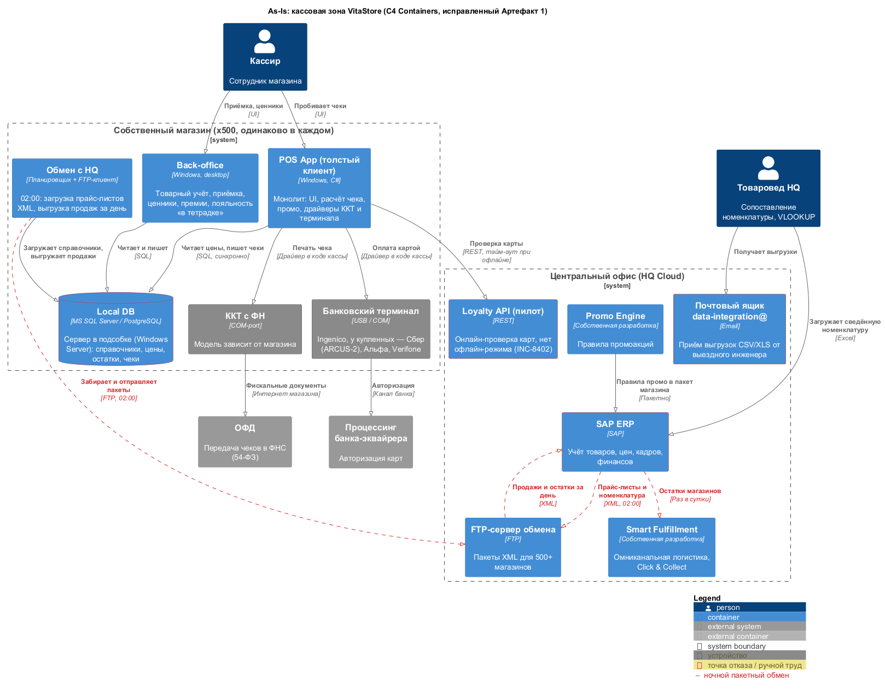

# 2. As-Is: проверка Артефакта 1 и исправленная схема (C4 Containers)

## 2.1 Проверка валидности Артефакта 1

Схема с внутреннего Wiki сверена с регламентом (Артефакт 2), инцидентами (Артефакт 3) и описанием кейса. Вывод: **схема невалидна** — она показывает целевую картину, которой нет, и пропускает реальные потоки.

| № | Что на схеме | Что на самом деле | Источник | Исправление |
| --- | --- | --- | --- | --- |
| 1 | `POS App → SAP ERP`: «Real-time stock & loyalty update», REST | Цены и номенклатура приходят ночным XML по FTP в 02:00; продажи уходят в HQ пакетом | Артефакт 2, п. 7.1; G4 | Потоки через FTP-сервер обмена, помечены как ночной обмен |
| 2 | Лояльность ведёт SAP | В магазинах лояльность «в тетрадке»; онлайн-проверка карт — отдельный пилотный сервис без офлайна | INC-8402; G5 | Отдельный контейнер Loyalty API (пилот) с тайм-аутом при офлайне |
| 3 | Один терминал Ingenico (USB) | Разнородный парк: Сбер (ARCUS-2), Альфа, Ingenico, Verifone | INC-8415, Cost Driver 3; G7 | Терминал без привязки к вендору, перечень моделей |
| 4 | Нет ОФД и процессинга банка | ККТ обязана передавать чеки в ОФД (54-ФЗ), терминал авторизует карту в процессинге банка | 54-ФЗ | Добавлены внешние системы ОФД и процессинг |
| 5 | В HQ только SAP | В HQ ещё Promo Engine и Smart Fulfillment; номенклатура M&A заводится через email и Excel | Описание кейса, Артефакт 2 | Добавлены Promo Engine, Smart Fulfillment, почтовый ящик, товаровед |
| 6 | Нет back-office и обмена | В магазине есть back-office (товарный учёт, приёмка, ценники, премии) и планировщик обмена с HQ | Описание кейса, Task1 | Добавлены контейнеры Back-office и «Обмен с HQ» |
| 7 | `C4Context` при заголовке «Container Diagram»; ККТ и терминал — контейнеры | Устройства — не программные контейнеры | Нотация C4 | Диаграмма уровня Containers; устройства — внешние элементы с тегом «устройство» |
| 8 | Local DB — «MS SQL Express» | Парк смешанный (MS SQL разных редакций и PostgreSQL) на сервере в подсобке под Windows Server | Описание кейса; G6 | MS SQL Server / PostgreSQL, сервер в подсобке |
| 9 | SAP ERP в «HQ Cloud» | SAP описан как on-premise | Описание кейса; G1 | Оставлено «HQ Cloud» по [ADR-001](../Task1/adr/ADR-001-hq-in-cloud.md) |

## 2.2 Исправленная схема

Периметр — типовой собственный магазин и HQ. Схема одинакова для всех 500 магазинов ([ADR-002](../Task1/adr/ADR-002-scope-all-stores.md)).

Исходник: [as-is-containers.puml](as-is-containers.puml)

**Купленный магазин** до онбординга работает на своей кассовой системе (1С:Розница, Frontol, Эвотор и др.) со своей БД, своими ККТ и терминалами. С HQ VitaStore он не интегрирован: номенклатура переносится выгрузкой в email ([Task2](../Task2/02-to-be-process.md)), а при переходе на стек VitaStore устанавливается тот же толстый клиент с Local DB. Поэтому отдельная схема для него не нужна: это та же картина плюс ручной перенос данных.

## 2.3 Архитектурные проблемы As-Is

| Проблема | Где на схеме | Последствие | Инцидент / Cost Driver |
| --- | --- | --- | --- |
| Сервер в подсобке — единая точка отказа | Local DB | Магазин стоит 4-6 часов до приезда инженера | INC-8433 |
| Драйверы устройств внутри монолита кассы | POS App → ККТ, терминал | Новый терминал — новый драйвер и пересборка кассы (3 недели) | INC-8415, Cost Driver 3 |
| Синхронная зависимость от облака без офлайна | POS App → Loyalty API | При обрыве связи лояльность недоступна, покупатели уходят | INC-8402 |
| Ночной пакетный обмен | Обмен с HQ ↔ FTP ↔ SAP | Цены и остатки опаздывают на сутки; Smart Fulfillment видит вчерашние остатки | Артефакт 2 |
| 500+ копий одного стека | Весь контур магазина | Лицензии Windows Server / SQL, железо, выезды инженеров | Cost Driver 2 |
| Ручной перенос номенклатуры | Почтовый ящик, товаровед, Excel | До 2 недель на магазин | Cost Driver 1, Артефакт 4 |
