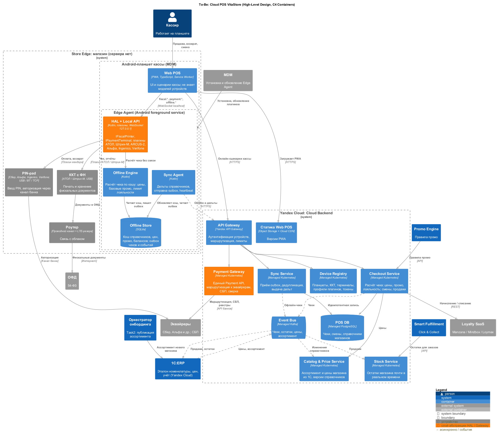
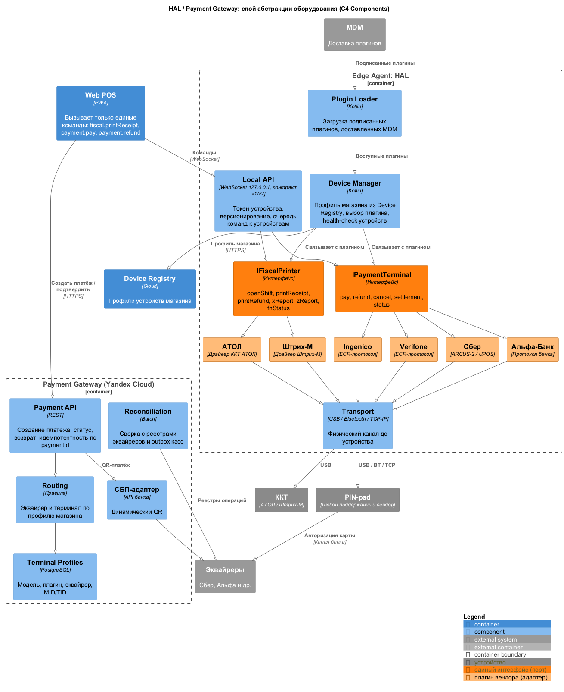

# 3. To-Be: целевая облачная архитектура (High-Level Design)

## 3.1 Принципы

1. **В магазине нет сервера и БД.** Остаются Android-планшет, ККТ, PIN-pad и роутер с LTE-резервом ([ADR-002](../Task1/adr/ADR-002-scope-all-stores.md), [ADR-007](adr/ADR-007-edge-agent-hal.md)).
2. **Логика и данные — в облаке** (Yandex Cloud, [ADR-001](../Task1/adr/ADR-001-hq-in-cloud.md)). Cloud POS — собственная разработка на PaaS ([ADR-006](adr/ADR-006-own-cloud-pos.md)).
3. **Касса не знает модель устройства.** Работа с «железом» вынесена в HAL на планшете, работа с банками — в облачный Payment Gateway.
4. **Офлайн — штатный режим, а не авария.** Edge Agent держит кэш и outbox, чтобы продавать при обрыве связи ([ADR-008](adr/ADR-008-offline-mode.md), [04-offline-sync.md](04-offline-sync.md)).
5. **Событийная интеграция** через Managed Kafka вместо ночного FTP. Эталон номенклатуры и цен — 1С:ERP ([ADR-003](../Task1/adr/ADR-003-sap-to-1c.md)).

## 3.2 Архитектурная схема

Исходник: [to-be-hld.puml](to-be-hld.puml)

### Компоненты в магазине (Edge / Tablet)

| Компонент | Технология | Назначение |
| --- | --- | --- |
| Web POS | PWA (TypeScript), Service Worker | UI и сценарии кассы. Загружается из CDN, обновляется без выезда. Вызывает облако онлайн и Edge Agent локально |
| Edge Agent: HAL + Local API | Kotlin, Android foreground service | Единые команды для ККТ и терминалов; плагины вендоров. **Слой абстракции оборудования** |
| Edge Agent: Offline Engine | Kotlin | Расчёт чека по кэшу при обрыве связи |
| Edge Agent: Offline Store | SQLite | Кэш справочников, цен, промо, балансов лояльности; outbox чеков и событий |
| Edge Agent: Sync Agent | Kotlin | Дельты справочников, отправка outbox, heartbeat |
| ККТ с ФН | АТОЛ / Штрих-М | Фискальный чек (54-ФЗ), передача в ОФД |
| PIN-pad | Сбер, Альфа, Ingenico, Verifone | Ввод PIN, авторизация через канал банка |
| Роутер | Проводной канал + LTE | Связь с облаком; LTE-резерв сокращает офлайн |

### Компоненты в облаке (Cloud Backend, Yandex Cloud)

| Компонент | Сервис Yandex Cloud | Назначение |
| --- | --- | --- |
| Статика Web POS | Object Storage + Cloud CDN | Версии PWA, канареечные выкладки по группам магазинов |
| API Gateway | Yandex API Gateway | Единая точка входа, mTLS / токен устройства, лимиты |
| Checkout Service | Managed Kubernetes | Расчёт чека онлайн: цены, промо (Promo Engine), лояльность (SaaS), смены, продажи |
| Catalog & Price Service | Managed Kubernetes | Ассортимент и цены магазина из 1С:ERP, версии справочников для дельт |
| Stock Service | Managed Kubernetes | Остатки магазина почти в реальном времени для 1С и Smart Fulfillment |
| Sync Service | Managed Kubernetes | Приём outbox, дедупликация по ключу идемпотентности, выдача дельт |
| Device Registry | Managed Kubernetes | Реестр планшетов, ККТ, терминалов; профили плагинов; токены устройств |
| **Payment Gateway** | Managed Kubernetes | Единый Payment API, маршрутизация к эквайрерам, СБП, сверка |
| POS DB | Managed PostgreSQL | Чеки, смены, справочники магазинов |
| Event Bus | Managed Kafka | События чеков, остатков, цен, ассортимента |

Внешние и смежные системы: 1С:ERP, Promo Engine, Smart Fulfillment, оркестратор онбординга ([Task2](../Task2/02-to-be-process.md)), Loyalty SaaS, ОФД, эквайреры, MDM.

## 3.3 Слой абстракции оборудования: HAL и Payment Gateway

Исходник: [hal-components.puml](hal-components.puml)

Слой построен по схеме «порты и адаптеры»:

- **Порты** — два единых интерфейса в Edge Agent. `IFiscalPrinter`: открыть смену, напечатать чек, напечатать возврат, X/Z-отчёт, статус ФН. `IPaymentTerminal`: оплата, возврат, отмена, сверка итогов, статус. Web POS знает только эти команды через Local API.
- **Адаптеры** — плагины вендоров: АТОЛ, Штрих-М для ККТ; Сбер (ARCUS-2 / UPOS), Альфа-Банк, Ingenico, Verifone для терминалов. Плагин переводит единую команду в протокол устройства и работает через USB, Bluetooth или TCP/IP.
- **Device Manager** выбирает плагин по профилю магазина из Device Registry. **Plugin Loader** принимает только подписанные плагины, доставленные MDM.
- **Payment Gateway** закрывает облачную сторону: создаёт платёж с идемпотентным `paymentId`, выбирает эквайрера и терминал по профилю, формирует QR СБП, сверяет реестры банков с outbox касс.

**Оплата картой:**

1. Web POS создаёт платёж в Payment Gateway и получает `paymentId` и профиль терминала.
2. Web POS вызывает `payment.pay(paymentId, amount)` в Local API.
3. HAL через плагин вендора запускает операцию на PIN-pad. Терминал авторизует карту через канал банка; PAN и PIN не покидают терминал.
4. HAL возвращает результат (код авторизации, RRN, маскированный номер), Web POS подтверждает платёж в Payment Gateway.
5. Web POS вызывает `fiscal.printReceipt` — ККТ печатает чек.

**Подключение нового терминала (INC-8415):**

| Ситуация | Что делается | Пересборка Web POS / backend |
| --- | --- | --- |
| Модель уже поддержана | Профиль терминала в Payment Gateway и Device Registry | Нет |
| Новый вендор или протокол | Новый плагин Edge Agent + профиль; выкатка через MDM | Нет |
| Новый эквайрер для СБП / реестров | Адаптер эквайрера в Payment Gateway | Только Payment Gateway |

## 3.4 Переход от толстого клиента к Cloud-Native

| Аспект | As-Is (толстый клиент) | To-Be (Cloud-Native) | Что это даёт |
| --- | --- | --- | --- |
| Клиент кассы | Монолит C# под Windows, ставится в каждом магазине | Web POS (PWA) из CDN + Edge Agent через MDM | Обновление всей сети без выездов |
| Бизнес-логика | В монолите на каждой кассе | Checkout, Catalog, Stock в облаке; урезанный Offline Engine на планшете | Одна реализация правил вместо 500+ копий |
| Данные магазина | Local DB на сервере в подсобке | POS DB (Managed PostgreSQL) + кэш SQLite на планшете | Нет сервера, лицензий Windows Server / SQL и единой точки отказа (INC-8433) |
| Драйверы устройств | Внутри кассы, сборка под каждое устройство | HAL-плагины в Edge Agent | Новый терминал без пересборки кассы (INC-8415) |
| Платежи | Прямая связка касса — терминал | Payment Gateway + HAL | Мультиэквайринг, СБП, сверка на уровне сети |
| Обмен с HQ | Ночной XML по FTP в 02:00 | События Managed Kafka почти в реальном времени | Цены и остатки без суточной задержки |
| Лояльность | «Тетрадка» и пилотный онлайн-API без офлайна | Loyalty SaaS + офлайн-кэш и лимит списания | Карты работают при обрыве связи (INC-8402) |
| Офлайн | Работает, пока жив сервер в подсобке | Edge Agent: кэш + outbox, до 72 ч | Продажа за наличные с чеком без интернета |
| Масштабирование | Новый сервер и установка на каждый магазин | Регистрация планшета и устройств в Device Registry | Техническое подключение за часы |
| Наблюдаемость | Звонок в Service Desk | Heartbeat, статусы устройств и ФН, офлайн-метрики | Проактивная поддержка |

**Исчезает:** сервер в подсобке, Local DB, Windows Server и лицензии СУБД, FTP-сервер обмена, ночной пакет, драйверы в коде кассы, Loyalty API без офлайна.

**Появляется:** Web POS, Edge Agent (HAL, Offline Engine, Offline Store, Sync Agent), облачные сервисы POS, Payment Gateway, Device Registry, Event Bus, MDM.

**Меняется:** ККТ — стандарт АТОЛ / Штрих-М; терминалы — те же, но через HAL; SAP ERP → 1С:ERP.

## 3.5 Вклад в цели бизнеса

- **TCO магазина −40%:** уходят сервер, лицензии, выезды на аварии и обновления, поддержка 500+ разных установок. Облачные сервисы общие для всей сети. Расчёт — [Task4](../Task4/01-goal.md).
- **Онбординг за 5 дней:** техническое подключение магазина сводится к установке комплекта (планшет из MDM, ККТ с новым ФН, существующий терминал), регистрации в Device Registry и профилю в Payment Gateway. Номенклатура приходит из 1С событием ([Task2](../Task2/02-to-be-process.md), [ADR-004](../Task2/adr/ADR-004-onboarding-scope-and-channel.md)). Пробная продажа подтверждает готовность.
- **Автоматическая адаптация под платёжные системы:** новый терминал или банк подключается плагином и профилем, без пересборки кассы.
