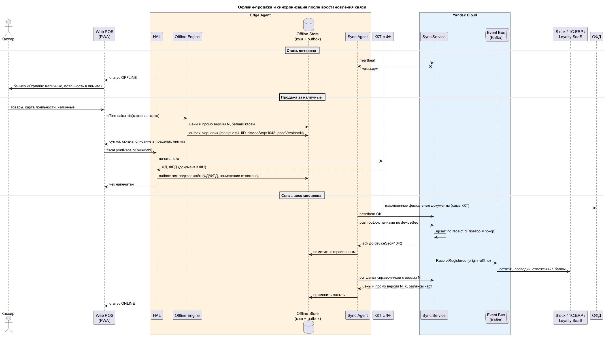

# 4. Офлайн-режим и синхронизация данных

## 4.1 Стратегия: три эшелона

1. **Не терять связь.** Роутер магазина с проводным каналом и резервным LTE. Переключение автоматическое, касса его не замечает.
2. **Продавать без связи.** Edge Agent на планшете держит кэш и outbox. Web POS при потере связи переключается на Offline Engine ([ADR-008](adr/ADR-008-offline-mode.md)).
3. **Восстановиться без потерь.** После возврата связи Sync Agent отправляет outbox и забирает дельты. Облако дедуплицирует и сверяет данные.

## 4.2 Что работает в офлайне

| Функция | Офлайн | Как |
| --- | --- | --- |
| Продажа за наличные + фискальный чек | Да | Offline Engine считает чек по кэшу, ККТ печатает и хранит в ФН |
| Базовые промо (скидки, N+1) | Да | Декларативные правила Promo Engine в кэше |
| Идентификация карты лояльности | Да | Снимок участников и балансов магазина |
| Начисление баллов | Отложенно | Событие в outbox, проводится после синхронизации |
| Списание баллов | В лимите | Не больше кэшированного баланса и офлайн-лимита на чек и на покупателя в сутки |
| Оплата картой | Если у терминала есть свой канал | Результат в outbox, сверка в Payment Gateway; floor limit не используется |
| СБП, персональные предложения, возврат безнала, Click & Collect | Нет | Нужна связь с облаком |

## 4.3 Что лежит в Offline Store

| Данные | Источник | Обновление | Оценка объёма |
| --- | --- | --- | --- |
| Ассортимент и цены магазина | Catalog & Price Service (из 1С:ERP) | Дельты по версии; полная загрузка при регистрации планшета | ~10 000 SKU, ~10 МБ |
| Правила промо | Promo Engine через Checkout Service | Дельты по версии | < 1 МБ |
| Снимок участников и балансов лояльности | Loyalty SaaS через Checkout Service | Раз в 15 минут + при восстановлении связи | ~5 МБ |
| Профили устройств | Device Registry | При изменении | < 1 МБ |
| Outbox: чеки, смены, события лояльности, платежи | Сам планшет | Накапливается в офлайне | ~2 КБ на чек, до 72 ч — единицы МБ |

Снимок лояльности содержит ПДн. Он шифруется на планшете, а MDM удалённо очищает устройство при утере (152-ФЗ).

## 4.4 Сценарий

Исходник: [offline-sync.puml](offline-sync.puml)

## 4.5 Механизм синхронизации при восстановлении связи

**Outbox и идемпотентность.** Каждая операция в офлайне — чек, смена, начисление или списание баллов, результат оплаты картой — записывается в outbox Offline Store до печати чека. Запись получает ключ идемпотентности `receiptId` (UUID, генерируется на планшете) и монотонный номер устройства `deviceSeq`. После печати ККТ запись дополняется фискальными реквизитами (ФД, ФПД). Когда heartbeat снова проходит, Sync Agent отправляет outbox в Sync Service пачками строго по возрастанию `deviceSeq`. Sync Service делает upsert по `receiptId`: повторная отправка после обрыва на середине пачки — no-op. В ответ Sync Service подтверждает последний принятый `deviceSeq`, и агент помечает записи до него отправленными. Затем Sync Service публикует события `ReceiptRegistered` с признаком `origin=offline` в Managed Kafka. Их независимо обрабатывают Stock Service (остатки), 1С:ERP (проводки и выручка), Checkout Service (отложенные начисления и списания в Loyalty SaaS) и Payment Gateway (сверка карточных операций). Фискальные документы в ОФД передаёт сама ККТ из ФН, поэтому фискализация не зависит от синхронизации кассы.

**Обратный поток — дельты справочников.** У каждого справочника (ассортимент, цены, промо, балансы) есть версия. Sync Agent запрашивает изменения с последней применённой версии и применяет их в одной транзакции SQLite. Порядок такой: сначала outbox, потом дельты. Так офлайн-чеки сначала попадают в облако по ценам, по которым были пробиты, и только потом касса получает новые цены. Если планшет был без связи дольше окна хранения дельт (7 дней) или заменён из подменного фонда, он получает полный снимок справочников магазина. Пока синхронизация не завершена, Web POS остаётся в режиме офлайн-расчёта, чтобы не смешивать версии цен в одном чеке.

**Разрешение конфликтов.** Пробитый фискальный чек — неизменяемый факт: облако принимает его по офлайн-цене (`priceVersion` в чеке) и не пересчитывает. Разница с новой ценой видна в отчёте об офлайн-продажах. Остаток может уйти в минус: Stock Service принимает продажу и создаёт задачу на пересчёт, если расхождение больше порога. Списание баллов сверх реального баланса (покупатель успел потратить их в другом магазине) ограничено офлайн-лимитом. Остаток долга погашается из будущих начислений, крупные расхождения уходят на разбор в службу лояльности. Карточные операции, одобренные терминалом в офлайне кассы, сверяются Payment Gateway с реестром эквайрера. Запись без пары в реестре — инцидент для финансов, а не автоматический возврат.

## 4.6 Мониторинг

- Heartbeat планшета каждые 30 секунд. Если связи нет больше 15 минут, Service Desk получает алерт, а магазин переключается на LTE или вызывает провайдера.
- Метрики: длительность офлайна, размер outbox, возраст самой старой неотправленной записи, отставание версии справочников, дни до блокировки ФН без передачи в ОФД.
- Пороги: outbox старше 24 часов — инцидент второй линии; до блокировки ФН меньше 3 дней — критический инцидент.
