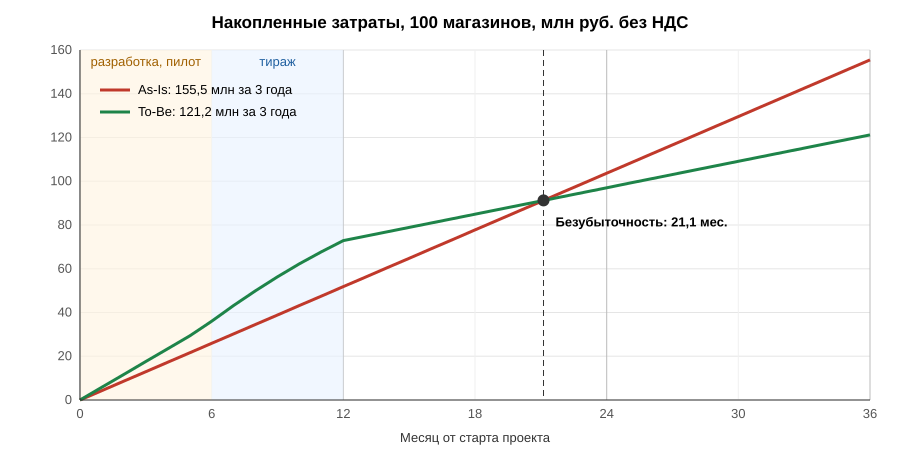

# 2. Расчёт TCO: 100 магазинов, 3 года

## 2.1 Периметр и методика

- **Периметр:** 100 существующих магазинов сети, по 2 кассы в каждом ([ADR-010](adr/ADR-010-tco-perimeter-and-allocation.md)).
- **Горизонт:** 36 месяцев от старта проекта. Расчёт помесячный, кассовый (CapEx — в месяце затрат), рубли без НДС, цены 2026 года без индексации ([ADR-009](adr/ADR-009-training-price-assumptions.md)).
- **As-Is:** толстый клиент C# + сервер в подсобке с Windows Server и SQL Server, ночной обмен с ERP по FTP, поддержка Team Store Ops с выездами ([Task3, 02-as-is.md](../Task3/02-as-is.md)).
- **To-Be:** Android-планшет с Web POS и Edge Agent, ККТ АТОЛ / Штрих-М, роутер с LTE-резервом; собственный Cloud POS на PaaS Yandex Cloud ([ADR-006](../Task3/adr/ADR-006-own-cloud-pos.md), [ADR-007](../Task3/adr/ADR-007-edge-agent-hal.md)); онбординг через SKU Matching без выезда инженера ([Task2](../Task2/README.md)).
- **Общие затраты платформы** (разработка, фиксированная часть облака, продуктовая команда) относятся на периметр в доле 100/500 = 20%. В той же доле As-Is несёт команду разработки толстого клиента.
- **Онбординг:** доля потока M&A — 10 магазинов в месяц × 20% = 24 магазина в год.
- **График перехода:**
  - месяцы 1-6 — разработка и пилот, 5 магазинов переходят в месяце 6;
  - месяцы 7-12 — тираж остальных 95 магазинов;
  - в месяце перехода магазин несёт затраты обоих сценариев (параллельная работа).
- **Метрики:**
  - ROI = экономия за 3 года / разовые инвестиции To-Be;
  - точка безубыточности — месяц, когда накопленные затраты To-Be сравниваются с As-Is;
  - NPV разницы потоков по ставке 20% годовых;
  - цель кейса «−40%» проверяется на установившемся Годе 3 в расчёте на магазин.

### Что входит в строки

| Статья | As-Is | To-Be |
| --- | --- | --- |
| Оборудование (CapEx) | Обновление серверов, ИБП и кассовых ПК по циклу 5 лет | Комплект: 2 планшета + подменный фонд, роутер с LTE, замена 30% ККТ на АТОЛ / Штрих-М; далее — замена отказавших планшетов. Магазины до перехода — как As-Is |
| Разработка платформы (CapEx) | — | Cloud POS, Edge Agent / HAL, Payment Gateway, плагины, SKU Matching — доля 20% |
| Миграция магазинов (разово) | — | Монтаж, обучение кассиров, вывод сервера и архивирование данных |
| Лицензии и подписки (OpEx) | Windows Server + SQL Server, ОС касс, антивирус | MDM с защитой планшетов |
| Облачная инфраструктура (OpEx) | Доля центрального обмена (FTP, XML) | Yandex Cloud: фиксированная часть (доля 20%) + переменная на магазин |
| ФОТ поддержки и разработки | Store Ops (1 инженер на 25 магазинов) + команда толстого клиента (доля 20%) | 1 инженер на 100 магазинов + продуктовая команда POS (доля 20%) |
| Выезды и простои | 4 выезда в год, отказы сервера (INC-8433) | 1 выезд в год, курьерская замена планшета, остаточные потери |
| Каналы связи | Проводной канал | Проводной канал + резервный LTE |
| Общие сервисы | ОФД, ФН, аренда терминалов, SaaS-лояльность | То же — в обоих сценариях одинаково |
| Онбординг купленных | Выезд бригады из 2 инженеров на 5 дней + 24 ч товароведа | Монтаж за 1 день + 5 ч товароведа |

Расчёт и таблицы ниже генерирует скрипт [tco_model.py](tco_model.py) (раздел 2.5). Не редактируйте блок между маркерами вручную.

## 2.2 Допущения, таблица TCO и чувствительность

<!-- TCO:BEGIN -->

### Реестр допущений

Генерируется из `PARAMS` в [tco_model.py](tco_model.py). «Оценка» — учебная экспертная цена ([ADR-009](adr/ADR-009-training-price-assumptions.md)).

| Параметр | Значение | Единица | Источник |
| --- | ---: | --- | --- |
| **Периметр и график** | | | |
| Магазинов в периметре | 100 | магазинов | постановка Task4 |
| Магазинов в сети | 500 | магазинов | описание кейса |
| Касс в магазине | 2 | касс | ADR-010 |
| Доля общих затрат платформы на периметр (100/500) | 0,2 | доля | ADR-010 |
| Разработка и пилот | 6 | мес. | ADR-010 |
| Пилотных магазинов (переход в последний месяц разработки) | 5 | магазинов | ADR-010 |
| Тираж остальных магазинов | 6 | мес. | ADR-010 |
| Горизонт расчёта | 36 | мес. | постановка Task4 |
| **Ставки ФОТ (с взносами и накладными)** | | | |
| Инженер поддержки L2 (оклад ~120 тыс./мес.) | 1 900 000 | руб./год | оценка |
| Разработчик / инженер продукта (оклад ~270 тыс./мес.) | 4 200 000 | руб./год | оценка |
| Рабочих дней в году | 247 | дней | производственный календарь |
| Час товароведа | 1 100 | руб./ч | оценка |
| **As-Is: магазин** | | | |
| Сервер в подсобке (RAID, 2 диска) | 250 000 | руб. | оценка |
| ИБП сервера | 25 000 | руб. | оценка |
| POS-моноблок толстого клиента | 90 000 | руб./касса | оценка |
| Цикл обновления серверов и ПК (равномерно по парку) | 5 | лет | оценка |
| Windows Server + SQL Server (продление через партнёров) | 75 000 | руб./год | описание кейса, оценка |
| ОС кассового ПК | 5 000 | руб./касса/год | оценка |
| Антивирус (сервер и кассовые ПК) | 3 000 | руб./устройство/год | оценка |
| Доля центрального обмена (FTP, XML-пакеты ERP) | 3 000 | руб./магазин/год | Артефакт 2, оценка |
| Магазинов на одного инженера Store Ops (легаси) | 25 | магазинов | описание кейса, оценка |
| Команда толстого клиента на всю сеть | 6 | FTE | INC-8415, оценка |
| Плановые и аварийные выезды инженера | 4 | выездов/магазин/год | оценка |
| Выезд инженера (день работы + транспорт) | 15 000 | руб./выезд | оценка |
| Вероятность отказа сервера за год | 0,1 | доля/год | INC-8433, оценка |
| Простой 6 ч (упущенная маржа) + аварийный выезд | 45 000 | руб./инцидент | INC-8433, оценка |
| Проводной интернет магазина | 3 000 | руб./мес. | оценка |
| **To-Be: магазин** | | | |
| Android-планшет + подставка и USB-хаб | 40 000 | руб./касса | ADR-007, оценка |
| Подменный фонд планшетов | 0,05 | доля | Task1 9.3, оценка |
| Роутер с резервным LTE | 15 000 | руб./магазин | Task1 9.1, оценка |
| Нестандартные ККТ под замену на АТОЛ / Штрих-М | 0,3 | доля касс | ADR-007, оценка |
| ККТ АТОЛ / Штрих-М | 32 000 | руб./ККТ | оценка |
| Перерегистрация ККТ в ФНС | 3 000 | руб./ККТ | оценка |
| Отказы планшетов (замена из подменного фонда) | 0,05 | доля/год | оценка |
| Доставка подменного планшета курьером | 1 500 | руб./замена | оценка |
| MDM + защита (Kaspersky / SafePhone) | 2 500 | руб./планшет/год | Task1 5.3, оценка |
| Переменная часть Yandex Cloud (вычисления, БД, трафик) | 600 | руб./магазин/мес. | оценка |
| Магазинов на одного инженера (стандартный стек, MDM) | 100 | магазинов | оценка |
| Выезды (ККТ, сеть) | 1 | выезд/магазин/год | оценка |
| Остаточные потери от сбоев (вторая касса, LTE, офлайн) | 1 000 | руб./магазин/год | ADR-008, оценка |
| Резервный LTE-канал | 800 | руб./мес. | оценка |
| Монтаж (25 тыс.), обучение (5 тыс.), вывод сервера (5 тыс.) | 35 000 | руб./магазин | оценка |
| **To-Be: платформа (вся сеть)** | | | |
| Команда Cloud POS, Edge Agent / HAL, Payment Gateway | 14 | FTE | ADR-006, ADR-007, оценка |
| Команда SKU Matching и оркестратора онбординга | 5 | FTE | Task2, оценка |
| SDK вендоров, сертификация плагинов, пентест | 5 000 000 | руб. | оценка |
| Множитель бюджета разработки (чувствительность) | 1 | × | оценка |
| Продуктовая команда POS после запуска | 8 | FTE | ADR-006, оценка |
| Фиксированная часть Yandex Cloud: Managed K8s, PostgreSQL, Kafka, окружения | 450 000 | руб./мес. | оценка |
| Фиксированная часть облака в период разработки (dev / stage) | 0,5 | доля | оценка |
| Множитель цен облака (чувствительность) | 1 | × | оценка |
| **Общие для обоих сценариев** | | | |
| ОФД | 3 000 | руб./касса/год | Task1 1.3, оценка |
| Фискальный накопитель | 9 000 | руб. | оценка |
| Срок ФН | 15 | мес. | оценка |
| Аренда банковского терминала | 1 000 | руб./касса/мес. | оценка |
| SaaS-лояльность (Manzana / Mindbox) | 15 000 | руб./магазин/год | Task1 2.1, оценка |
| **Онбординг купленных магазинов** | | | |
| Поток M&A по сети | 10 | магазинов/мес. | Артефакт 4 |
| As-Is: ИТ-бригада на выезде | 2 | чел. | описание кейса, оценка |
| As-Is: длительность выезда | 5 | дней | оценка |
| As-Is: суточные и гостиница | 5 000 | руб./чел./день | оценка |
| As-Is: дорога в регион и обратно | 15 000 | руб./чел. | оценка |
| As-Is: товаровед, 16 ч маппинга + 8 ч исправления ошибок | 24 | ч | Task2 G14-G15 |
| To-Be: монтаж комплекта (1 день) | 25 000 | руб. | Task2 ADR-004, оценка |
| To-Be: товаровед на проверку AI-маппинга | 5 | ч | Task2 |
| **Финансы** | | | |
| Ставка дисконтирования для NPV | 0,2 | в год | ADR-010 |

Производные величины базового сценария:

- Разработка платформы на всю сеть: 44,9 млн руб., доля периметра — 9,0 млн руб.
- Комплект To-Be на магазин: 120 000 руб. оборудования + 35 000 руб. услуг миграции.
- Онбординг одного купленного магазина: As-Is 183 323 руб., To-Be 30 500 руб.
- Месячные затраты магазина: As-Is 39 525 руб., To-Be 13 029 руб. (без общих затрат платформы).

### Таблица TCO, млн руб. без НДС

| Статья | As-Is Г1 | As-Is Г2 | As-Is Г3 | **As-Is Σ** | To-Be Г1 | To-Be Г2 | To-Be Г3 | **To-Be Σ** | Δ Σ |
| --- | ---: | ---: | ---: | ---: | ---: | ---: | ---: | ---: | ---: |
| Оборудование (CapEx) | 9,1 | 9,1 | 9,1 | **27,3** | 19,2 | 0,4 | 0,4 | **20,0** | −7,3 |
| Разработка платформы (CapEx) | 0,0 | 0,0 | 0,0 | **0,0** | 9,0 | 0,0 | 0,0 | **9,0** | 9,0 |
| Миграция магазинов (разово) | 0,0 | 0,0 | 0,0 | **0,0** | 3,5 | 0,0 | 0,0 | **3,5** | 3,5 |
| Лицензии и подписки (OpEx) | 9,4 | 9,4 | 9,4 | **28,2** | 7,5 | 0,5 | 0,5 | **8,5** | −19,7 |
| Облачная инфраструктура (OpEx) | 0,3 | 0,3 | 0,3 | **0,9** | 1,3 | 1,8 | 1,8 | **4,9** | 4,0 |
| ФОТ поддержки и разработки | 12,6 | 12,6 | 12,6 | **37,9** | 13,8 | 8,6 | 8,6 | **31,0** | −6,9 |
| Выезды и простои | 6,5 | 6,5 | 6,5 | **19,4** | 5,5 | 1,6 | 1,6 | **8,7** | −10,6 |
| Каналы связи | 3,6 | 3,6 | 3,6 | **10,8** | 4,2 | 4,6 | 4,6 | **13,3** | 2,5 |
| Общие: ОФД, ФН, терминалы, лояльность | 5,9 | 5,9 | 5,9 | **17,8** | 6,4 | 5,9 | 5,9 | **18,3** | 0,5 |
| Онбординг купленных (24 магазина/год) | 4,4 | 4,4 | 4,4 | **13,2** | 2,6 | 0,7 | 0,7 | **4,0** | −9,2 |
| **Итого** | **51,8** | **51,8** | **51,8** | **155,5** | **72,9** | **24,2** | **24,2** | **121,2** | **−34,3** |

Δ — To-Be минус As-Is: отрицательное значение — экономия.

### Итог по годам, млн руб.

| Показатель | Год 1 | Год 2 | Год 3 | Σ 3 года |
| --- | ---: | ---: | ---: | ---: |
| TCO As-Is | 51,8 | 51,8 | 51,8 | 155,5 |
| TCO To-Be | 72,9 | 24,2 | 24,2 | 121,2 |
| Экономия (As-Is − To-Be) | −21,0 | 27,7 | 27,7 | 34,3 |
| Накопленная экономия | −21,0 | 6,6 | 34,3 | — |

### Финансовые показатели

| Показатель | Значение |
| --- | ---: |
| Разовые инвестиции To-Be (доля разработки, комплекты, миграция) | 24,5 млн руб. |
| Экономия за 3 года | 34,3 млн руб. |
| Снижение TCO за 3 года | −22% |
| ROI за 3 года (экономия / инвестиции) | 140% |
| NPV экономии при 20% годовых | 19,2 млн руб. |
| Точка безубыточности (от старта проекта) | 21,1 мес. |
| Дисконтированный срок окупаемости | 22,9 мес. |
| Минимальный размер сети, при котором платформа окупается за 3 года | 228 магазинов |

### Проверка цели кейса: установившийся год (Год 3) на один магазин, руб./год

| Срез | As-Is | To-Be | Изменение |
| --- | ---: | ---: | ---: |
| TCO магазина (без онбординга) | 474 300 | 234 350 | −51% |
| TCO магазина без общих сервисов (ОФД, ФН, терминалы, лояльность) | 414 900 | 174 950 | −58% |
| ИТ-поддержка: ФОТ поддержки и разработки, выезды и простои | 190 900 | 102 350 | −46% |

### Анализ чувствительности

| Сценарий | TCO As-Is, млн | TCO To-Be, млн | Экономия, млн | ROI | NPV, млн | Безубыточность | Δ TCO магазина, Г3 |
| --- | ---: | ---: | ---: | ---: | ---: | ---: | ---: |
| Базовый (`base`) | 155,5 | 121,2 | 34,3 | 140% | 19,2 | 21,1 мес. | −51% |
| Все затраты платформы — на 100 магазинов (`full-capex`) | 155,5 | 236,2 | −80,7 | −134% | −72,6 | не окупается | +15% |
| Облако +30% (`cloud+30`) | 155,5 | 122,6 | 32,9 | 134% | 18,2 | 21,4 мес. | −49% |
| Облако −30% (`cloud-30`) | 155,5 | 119,8 | 35,7 | 146% | 20,3 | 20,8 мес. | −52% |
| Бюджет разработки +50% (`dev+50`) | 155,5 | 125,7 | 29,8 | 103% | 15,0 | 23,1 мес. | −51% |
| Тираж 12 мес. вместо 6 (`slow-rollout`) | 155,5 | 128,7 | 26,7 | 109% | 13,6 | 24,4 мес. | −51% |
| As-Is: 1 инженер на 40 магазинов (`asis-lean`) | 146,9 | 119,0 | 28,0 | 114% | 14,7 | 22,5 мес. | −47% |

<!-- TCO:END -->

## 2.3 График окупаемости

## 2.4 Итоговый вывод

**Переход выгоден при масштабе сети: проект окупается примерно за 21 месяц от старта, или через ~9 месяцев после завершения тиража.** Цифры базового сценария на учебных ценах ([ADR-009](adr/ADR-009-training-price-assumptions.md)):

- **TCO за 3 года:** 155,5 млн руб. As-Is против 121,2 млн руб. To-Be. Экономия — 34,3 млн руб. (−22%), ROI — 140% на 24,5 млн руб. разовых инвестиций, NPV при 20% — 19,2 млн руб.
- **Год 1 — дороже As-Is на 21 млн руб.** В него попадают доля разработки платформы, комплекты оборудования, миграция и параллельная работа: магазины до перехода продолжают нести затраты As-Is. С Года 2 To-Be стоит 24,2 млн руб. в год против 51,8 млн руб.
- **Цель кейса «−40% TCO магазина» достигается:** в установившемся Году 3 магазин стоит 234 тыс. руб. в год вместо 474 тыс. руб. (−51%). Без общих для обоих сценариев сервисов (ОФД, ФН, терминалы, лояльность) снижение — 58%; затраты на ИТ-поддержку снижаются на 46%. За 3 года в целом снижение меньше (−22%), потому что в Году 1 сосредоточены инвестиции.
- **Откуда экономия:**
  - лицензии Windows Server и SQL Server, обновление серверов и кассовых ПК — ~27 млн руб. за 3 года;
  - выезды и простои — ~11 млн руб.;
  - онбординг купленных магазинов без выезда бригады — ~9 млн руб.;
  - Store Ops в 4 раза компактнее.
- **Что дорожает:**
  - облако — +4 млн руб.;
  - резервный LTE — +2,5 млн руб.;
  - продуктовая команда POS вместо команды легаси — ФОТ разработки растёт, но перекрывается сокращением поддержки.
- **Вывод устойчив к ценам:** облако ±30%, бюджет разработки +50%, тираж 12 месяцев вместо 6 и более экономная поддержка As-Is сдвигают безубыточность в диапазон 21-24 месяцев, экономия остаётся в диапазоне 27-36 млн руб.
- **Главный риск — масштаб.** Если всю стоимость платформы несут только 100 магазинов, To-Be дороже As-Is на 81 млн руб. за 3 года и не окупается. Платформа окупается за 3 года при сети от ~230 магазинов. Значит, решение принимается на уровне всей сети 500+, а 100 магазинов — первая волна тиража, а не самостоятельный проект.
- **Не учтено в TCO** и работает в пользу To-Be:
  - упущенная маржа: купленный магазин открывается за 5 дней вместо 2 недель;
  - меньше отказов покупателей при обрыве связи (INC-8402, [ADR-008](../Task3/adr/ADR-008-offline-mode.md));
  - подключение нового терминала без пересборки кассы (INC-8415).

**Рекомендация:** запускать проект на всю сеть. Первые 100 магазинов использовать как пилот модели: фактические затраты на облако, поддержку и миграцию сверить с `PARAMS` и пересчитать модель до тиража на оставшиеся магазины.
